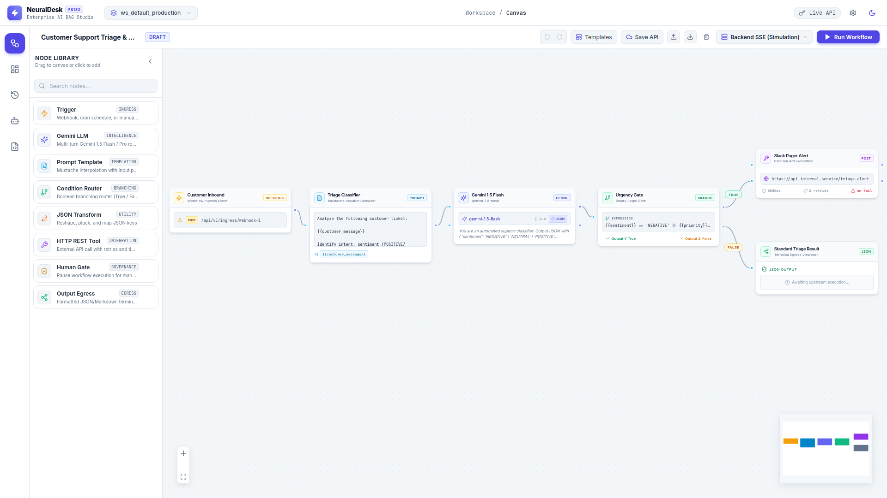
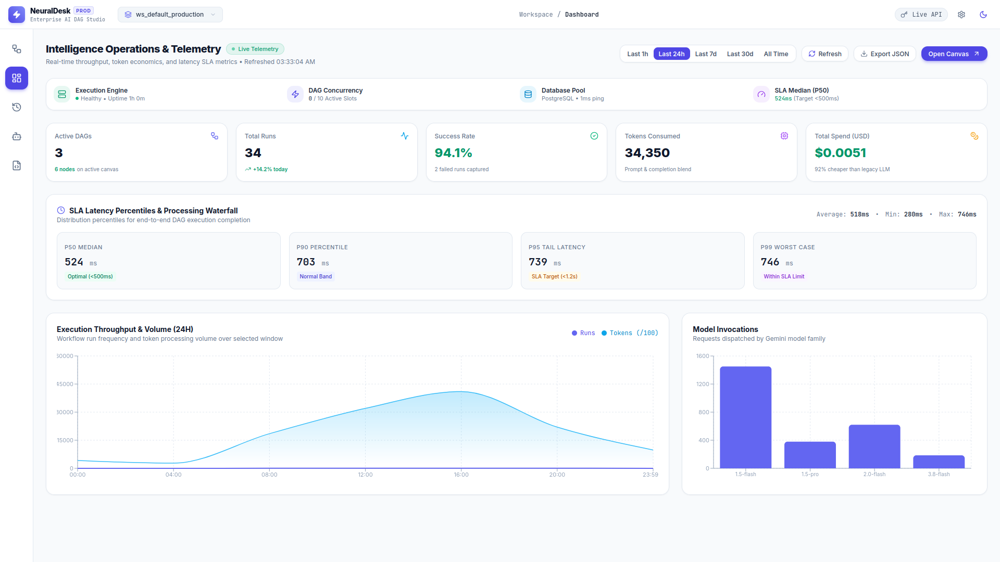
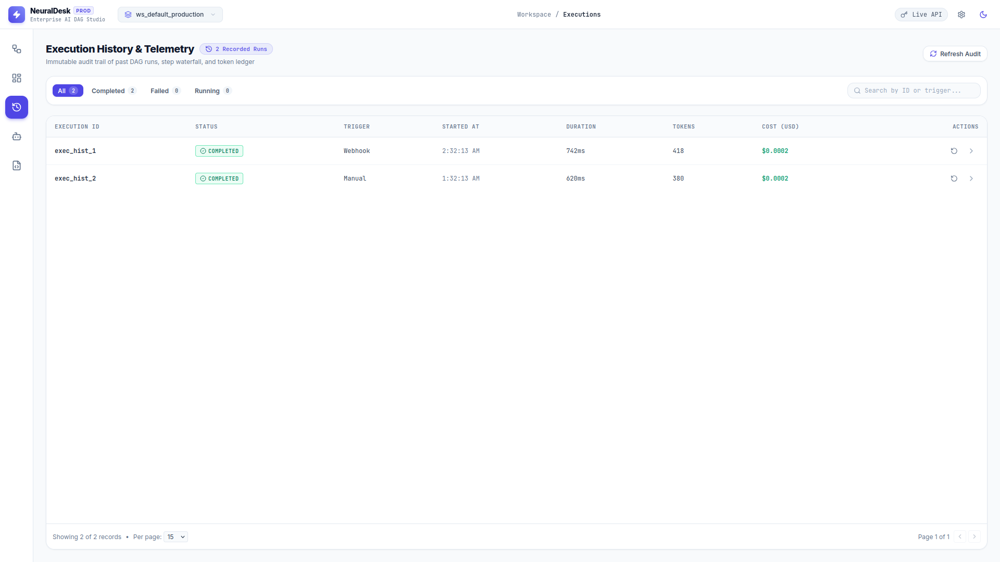
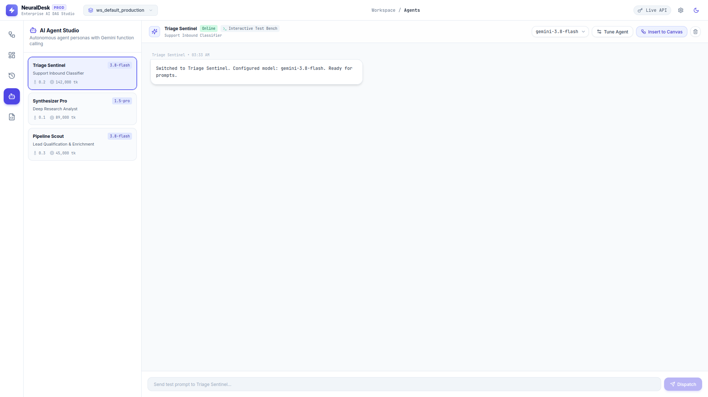
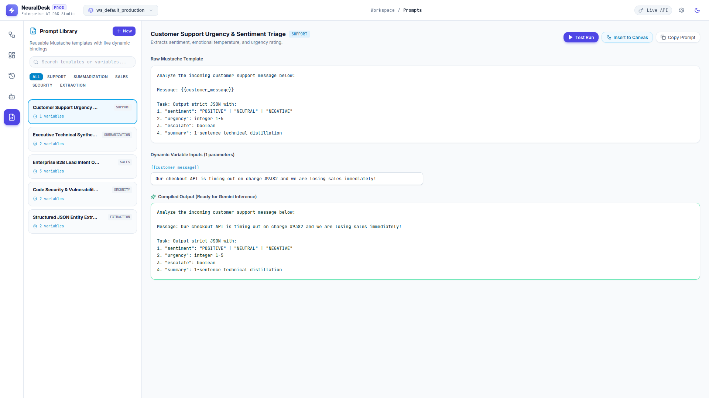

# NeuralDesk — Enterprise Visual AI Workflow Intelligence Platform

<div align="center">



<br/><br/>

**Orchestrate autonomous multi-model AI agent pipelines with deterministic DAG execution, real-time telemetry, and microsecond observability.**

<br/>

[](https://github.com/prasant-0n/NeuralDesk/actions/workflows/ci.yml)
[](https://www.typescriptlang.org/)
[](https://react.dev/)
[](https://hono.dev/)
[](https://ai.google.dev/)
[](https://reactflow.dev/)
[](https://www.postgresql.org/)
[](https://orm.drizzle.team/)
[](openapi.yaml)
[](docs/API_REFERENCE.md)
[](https://vitest.dev/)
[](https://playwright.dev/)
[](LICENSE)

<br/>

[**Live Architecture**](#-system-architecture) • [**Visual Showcase**](#-visual-walkthrough--modules) • [**API Reference**](#-api-documentation--interactive-explorer) • [**Key Features**](#-enterprise-feature-matrix) • [**Engineering Highlights**](#-engineering-highlights-for-technical-recruiters) • [**Quickstart**](#-quickstart--local-development) • [**Deployment**](#-production-deployment-blueprints)

</div>

---

## 🌟 Executive Summary

**NeuralDesk** is an enterprise-grade fullstack visual AI workflow intelligence and autonomous agent orchestration platform. Modern engineering teams constructing multi-model LLM pipelines frequently suffer from opaque "black-box" execution failures, unpredictable token expenditure, cyclic execution deadlocks, lack of human oversight, and nonexistent step-level debugging.

NeuralDesk solves this by transforming complex generative AI graphs into **visually inspectable, mathematically deterministic Directed Acyclic Graphs (DAGs)**. Every node execution is captured with microsecond resolution, prompt and completion token economics, estimated USD billing, and real-time streaming state updates broadcast via **Server-Sent Events (SSE)**.

---

## 📸 Visual Walkthrough & Modules

### 1. Visual DAG Workflow Canvas Engine
> Interactive node-graph editor with topological cycle protection, multi-branch routing, and live execution telemetry halos.

<div align="center">
  
</div>

* **8-Node Taxonomy:** Comprehensive palette containing `Trigger` (Webhook / Manual), `Prompt Template` (Mustache interpolation), `Gemini LLM` (1.5 Flash/Pro, 2.0), `Condition Router` (Boolean / AST branching), `JSON Transform` (Safe payload reshaping), `HTTP Tool` (External REST integrations with retry policies), `Human Gate` (HITL approval pauses), and `Output Egress` (Terminal sink).
* **Mathematical Cycle Invariants:** Prevents infinite recursive loops at the UI interaction layer using an in-memory **Kahn's Topological Sorting Algorithm** ($\mathcal{O}(V + E)$). Any edge creating a cycle is instantly rejected.
* **Dual Execution Modes:** Seamless toggle between **Server-side Live Gemini Inference** and a **Deterministic Simulation Mode** using seeded PRNG (MurmurHash3) for instant offline development and zero-cost testing.

---

### 2. Intelligence Operations & SLA Telemetry Dashboard
> Real-time executive metrics, percentile latency SLAs, token economics, and model invocation analytics.

<div align="center">
  
</div>

* **SLA Percentile Watermarks:** Real-time computation of **$P_{50}$ Median**, **$P_{90}$ Percentile**, **$P_{95}$ Tail Latency**, and **$P_{99}$ Worst-Case Latency** across all workflow executions.
* **Granular Token & Cost Accounting:** Live USD cost ledger based on Gemini pricing models ($0.075 / 1M prompt tokens, $0.30 / 1M completion tokens), tracking cumulative spend and token volume.
* **Interactive Recharts Visualizations:** Responsive area charts for workflow throughput over time and bar distributions of model invocations (Gemini 1.5 Flash, 1.5 Pro, 2.0 Flash, 3.8 Flash).
* **Telemetry Controls:** Multi-window filters (`Last 1h`, `Last 24h`, `Last 7d`, `Last 30d`, `All Time`), JSON metrics export, and system health status strip.

---

### 3. Immutable Execution Audit Trail & Trace Waterfall
> Step-by-step forensic execution debugger with live re-run replay and cancellation capabilities.

<div align="center">
  
</div>

* **Full Forensic Traces:** Detailed modal inspection displaying step-by-step latency waterfalls, node execution order, exact input parameters, and generated output payloads.
* **Execution Lifecycle Actions:** 1-click execution re-run replay (`POST /api/v1/executions/:id/rerun`) and live job abort (`POST /api/v1/executions/:id/cancel`).
* **Search & Filter:** Paginated audit ledger with filter tabs (`All`, `Completed`, `Failed`, `Running`) and search by Execution ID or Trigger type.

---

### 4. AI Agent Studio & Autonomous Persona Bench
> Multi-turn conversational playground with customizable agent personas, temperature tuning, and tool calling.

<div align="center">
  
</div>

* **Pre-Configured Agent Personas:** Specialized personas including `Triage Sentinel` (Support classifier), `Synthesizer Pro` (Deep research analyst), and `Pipeline Scout` (B2B lead enricher).
* **Live Function & Tool Calling:** Transparent visibility into agent tool invocations (`slack_pager_router`, `crm_lead_enricher`, `database_query`).
* **Model Switcher & Hyperparameters:** On-the-fly toggling between Gemini model variants (`gemini-1.5-flash`, `gemini-1.5-pro`, `gemini-2.0-flash`) and precision temperature sliders.
* **Canvas Integration:** 1-click **"Insert to Canvas"** button transfers configured agent personas directly into the visual DAG editor as an executable node.

---

### 5. Prompt Template Library & Live Mustache Compiler
> Version-controlled enterprise prompt repository with dynamic variable binding and token cost estimation.

<div align="center">
  
</div>

* **Dynamic Mustache Compilation:** Real-time variable extraction (`{{variable_name}}`) with dynamic input form generation and instantaneous preview rendering.
* **Integrated Test Runner:** Execute single-prompt test runs (`POST /api/v1/prompts/test`) with live token accounting and micro-cent cost calculation before adding to production workflows.
* **Categorized Taxonomy:** Organized prompt storage across `Support`, `Summarization`, `Sales`, `Security`, and `Data Extraction`.
* **Instant Injection:** 1-click **"Insert to Canvas"** bridges prompt engineering directly into workflow automation.

---

## 🏗️ System Architecture

```mermaid
flowchart TD
    subgraph ClientLayer["Frontend Presentation Tier (React 18 SPA)"]
        UI["Modern Web Client (Port 3000 / 80)"]
        CanvasView["Visual DAG Canvas (@xyflow/react)"]
        DashboardView["Operations Dashboard (Recharts)"]
        StudioView["AI Agent Studio (Multi-turn Chat)"]
        PromptView["Prompt Library (Mustache Compiler)"]
        ZustandStore["Reactive State Management (Zustand)"]
        UI --> CanvasView & DashboardView & StudioView & PromptView
        CanvasView & DashboardView & StudioView & PromptView <--> ZustandStore
    end

    subgraph EdgeLayer["Edge / Reverse Proxy Tier"]
        NginxEdge["Nginx / Vercel Edge CDN"]
    end

    subgraph BackendLayer["API & Orchestration Tier (Node.js 20 / Hono)"]
        HonoAPI["Hono REST Server (Port 3001)"]
        SSEHub["Server-Sent Events (SSE) Broadcast Hub"]
        Orchestrator["Topological DAG Execution Engine"]
        NodeHandlers["Node Handlers (Trigger, Prompt, LLM, Condition, Tool, Gate)"]
        SecurityLayer["AES-256-GCM BYOK & HMAC Webhook Validator"]
        
        HonoAPI --> SecurityLayer
        SecurityLayer --> Orchestrator
        Orchestrator --> NodeHandlers
        Orchestrator -.->|Micro-events| SSEHub
    end

    subgraph ExternalServices["External Infrastructure & AI Runtimes"]
        GeminiAPI["Google Gemini 1.5 / 2.0 Streaming API"]
        PostgresDB[("PostgreSQL 16 / Neon Serverless (Drizzle ORM)")]
        ExternalAPIs["External SaaS Tools (Slack, CRM, Webhooks)"]
    end

    UI <==>|HTTPS / REST API| NginxEdge
    UI <==|SSE Event Stream (text/event-stream)| NginxEdge
    NginxEdge <==> HonoAPI
    SSEHub -.->|Live node status & metrics| NginxEdge
    NodeHandlers <==>|@google/genai SDK| GeminiAPI
    NodeHandlers <==>|HTTP Dispatch| ExternalAPIs
    HonoAPI <==>|Pooled TLS (drizzle-orm)| PostgresDB
```

---

## 🔌 API Documentation & Interactive Explorer

NeuralDesk is engineered API-first with full **OpenAPI 3.1.0** compliance, providing rich machine-readable specifications and interactive documentation out of the box:

<div align="center">

| Documentation Surface | Endpoint / Link | Highlights |
|---|---|---|
| **Interactive API Explorer (Scalar)** | [`http://localhost:3001/docs`](http://localhost:3001/docs) or `/api/docs` | Modern dark/light UI with interactive "Try it out", schema viewer & multi-language code generation. |
| **Interactive Swagger UI** | [`http://localhost:3001/docs/swagger`](http://localhost:3001/docs/swagger) | Classic OpenAPI specification explorer. |
| **OpenAPI 3.1.0 JSON** | [`/api/v1/openapi.json`](http://localhost:3001/api/v1/openapi.json) or [`openapi.json`](openapi.json) | Full machine-readable OpenAPI schema (70+ KB) covering all 26+ routes. |
| **OpenAPI 3.1.0 YAML** | [`openapi.yaml`](openapi.yaml) | Standard YAML contract for Postman / Insomnia import and API gateways. |
| **Enterprise API Manual** | [**`docs/API_REFERENCE.md`**](docs/API_REFERENCE.md) | Exhaustive documentation with curl, TypeScript SDK & Python examples. |

</div>

### Key API Capabilities & Design Decisions:
* **RFC 7807 Problem Details:** Uniform structured error responses (`application/problem+json`) with validation field pointers and correlation trace IDs.
* **Push-Based Telemetry (SSE):** Real-time execution step waterfalls and token tracking streamed via HTTP `text/event-stream` (`/api/v1/executions/:id/stream`).
* **Zero-Leak BYOK Credential Vault:** Multi-tenant Gemini API keys encrypted at rest using **AES-256-GCM** and decrypted ephemerally in-memory during inference.
* **Cryptographic Webhook Security:** Timing-attack safe **HMAC-SHA256** signature verification (`X-NeuralDesk-Signature`) for external event triggers.

```bash
# 1. Trigger asynchronous DAG execution
curl -s -X POST http://localhost:3001/api/v1/workflows/wf_customer_support/execute \
  -H "Content-Type: application/json" \
  -H "Authorization: Bearer mock_jwt_admin_user" \
  -d '{"mode":"real","inputs":{"customerEmail":"cto@enterprise.com","subject":"Production Outage"}}' | jq

# 2. Subscribe to real-time execution telemetry stream (SSE)
curl -N -H "Authorization: Bearer mock_jwt_admin_user" \
  http://localhost:3001/api/v1/executions/exec_98af21d0/stream

# 3. Retrieve SLA Latency Percentiles (P50, P90, P95, P99)
curl -s http://localhost:3001/api/v1/executions/stats?timeframe=24h \
  -H "Authorization: Bearer mock_jwt_admin_user" | jq .slaMetrics
```

---

## 🎯 Engineering Highlights for Technical Recruiters

| Architectural Pillar | Implementation Details & Design Decision |
|---|---|
| **Topological DAG Invariants** | Implemented Kahn's algorithm in `@neuraldesk/shared` with $\mathcal{O}(V + E)$ complexity. Verifies acyclic invariants client-side upon connection attempt and server-side prior to graph execution. |
| **Dual-Engine Execution Architecture** | Features both real-world cloud streaming via Google Gemini API and a deterministic offline simulation engine utilizing seeded **MurmurHash3 PRNG**, allowing instant offline demos and deterministic CI tests. |
| **Micro-Telemetry via SSE** | Instead of polling, execution progress, node states (`pending` → `running` → `completed` / `failed`), and output tokens stream over persistent HTTP `text/event-stream` connections with automatic client reconnection. |
| **Zero-Leak Security (AES-256-GCM)** | Sensitive credentials (Gemini API keys, webhook signing secrets) are strictly isolated from the frontend. Multi-tenant BYOK credentials are encrypted at rest with AES-256-GCM and decrypted ephemerally in worker memory. |
| **Safe AST Logic Sandboxing** | Conditional node routing evaluates expressions using a deterministic AST tokenizer and parser. Zero usage of dangerous JavaScript `eval()` or `new Function()`. |
| **OpenAPI 3.1.0 & Interactive Explorer** | Native Scalar and Swagger UI endpoints with exhaustive JSON/YAML schemas, RFC 7807 problem details, and multi-language SDK examples. |
| **Monorepo Architecture** | Clean Turborepo / pnpm workspace structure separating `@neuraldesk/shared` (Zod schemas, contracts), `@neuraldesk/db` (Drizzle schema, migrations), `@neuraldesk/api` (Hono runtime), and `@neuraldesk/web` (React SPA). |
| **Complete Automated Verification** | 86 unit and integration tests across contracts, schemas, and orchestrator logic, plus 5 headless Playwright E2E browser journeys running on GitHub Actions. |

---

## 📊 Enterprise Feature Matrix

| Capability | NeuralDesk Feature | Traditional Automation (Zapier/Make) |
|---|---|---|
| **AI Native Architecture** | Native Google Gemini 1.5/2.0 streaming, temperature tuning, and system instructions | Generic single-shot wrappers |
| **Graph Topology** | Multi-input/multi-output Directed Acyclic Graphs with conditional branching | Linear or rigid branching |
| **Cycle Protection** | In-memory Kahn's algorithm prevents cycles at runtime and edit time | Runtime timeout errors |
| **Execution Observability** | Millisecond step waterfall, token count, USD cost calculation, and SSE halos | High-level status only |
| **Human Governance** | Built-in Human Gate with resume/reject tokens and approval state | Requires external forms / polling |
| **Autonomous Personas** | Dedicated Agent Studio with model switcher and function-calling cards | Limited / Nonexistent |
| **Prompt Engineering** | Mustache variable compiler with live test runner and cost estimator | Raw text input fields |
| **Deployment Model** | 100% Zero-Cost Cloud (Docker, Vercel, Render, Railway, Neon) or On-Premise | Vendor-locked proprietary cloud |

---

## 🛠️ Technology Stack

| Domain | Technology | Purpose |
|---|---|---|
| **Frontend Framework** | **React 18.3**, TypeScript 5.6, Vite 8 | High-performance SPA with client-side routing |
| **Canvas Engine** | **@xyflow/react v12** (React Flow) | Node-based visual graph editor with custom handles |
| **Styling & UI** | **Tailwind CSS**, Lucide React, clsx, tailwind-merge | Enterprise light & dark mode design system |
| **State Management** | **Zustand** with persistent storage | Reactive state across canvas, settings, and telemetry |
| **Data Visualization** | **Recharts 2.15** | Area volume charts and model invocation bar charts |
| **Backend Server** | **Hono 4.6** on Node.js 20 Alpine | Ultra-low latency, lightweight REST and SSE engine |
| **Database & ORM** | **PostgreSQL 16**, **Drizzle ORM**, Neon | Fully-typed schema, migrations, and connection pooling |
| **Validation & Schema** | **Zod 4 / 3** | Single source of truth for API contracts and env vars |
| **AI Provider** | **@google/genai SDK** | Native Google Gemini 1.5 Flash/Pro and 2.0 streaming |
| **Testing Harness** | **Vitest 2.1**, **Playwright**, **Puppeteer** | 84 unit/integration tests & full-suite browser journeys |
| **DevOps & Containers** | **Docker**, **Docker Compose**, Multi-stage builds | Production containerization and local orchestration |

---

## ⚡ Quickstart & Local Development

### Prerequisites
* **Node.js**: $\ge 20.x$
* **pnpm**: $\ge 9.x$ (`npm install -g pnpm`)
* **Docker & Docker Compose** (for containerized PostgreSQL)

### 1. Clone & Install
```bash
git clone https://github.com/prasant-0n/NeuralDesk.git
cd NeuralDesk
pnpm install
```

### 2. Configure Environment Variables
```bash
cp .env.example .env
```
*(The platform runs out-of-the-box with deterministic simulation mode enabled. Optionally add your `GEMINI_API_KEY` for live AI inference).*

### 3. Build Core Packages & Run Local Monorepo
```bash
# Build shared contracts and database models
pnpm build:packages

# Start frontend and backend concurrently in development mode
pnpm dev
```
* **Frontend Canvas:** [http://localhost:3000](http://localhost:3000)
* **API Server:** [http://localhost:3001](http://localhost:3001)
* **Health Check:** [http://localhost:3001/api/v1/health](http://localhost:3001/api/v1/health)

---

## 🐳 Docker Orchestration

To run the complete production stack (PostgreSQL 16, Hono API Server, and Nginx-powered Web Client) in containerized isolation:

```bash
# Build and launch all orchestrated containers
docker compose up -d --build

# View real-time container health
docker compose ps

# Follow structured server logs
docker compose logs -f api
```

---

## 🧪 Testing & Quality Assurance

NeuralDesk enforces a comprehensive 3-tier testing strategy:

```bash
# 1. Run Vitest Unit & Integration Suites (84 / 84 tests passing)
pnpm test

# 2. Run Monorepo Recursive Typecheck (0 TypeScript errors)
pnpm typecheck

# 3. Run Playwright End-to-End Headless Browser Journeys
pnpm test:e2e

# 4. Run Puppeteer Visual Automation Audit Harness
pnpm test:puppeteer
```

---

## 🚀 Production Deployment Blueprints

NeuralDesk includes turnkey deployment blueprints designed for zero-cost or scalable enterprise cloud hosting:

* **Railway Fullstack:** One-click deployment from GitHub with PostgreSQL plugin via [`railway.json`](railway.json).
* **Render Free Tier:** Pre-configured Infrastructure-as-Code Blueprint with auto-provisioned PostgreSQL via [`render.yaml`](render.yaml).
* **Vercel Edge:** Static frontend hosting with edge rewrite proxying via [`vercel.json`](apps/web/vercel.json).
* **Self-Hosted VPS:** Docker Compose with Nginx reverse proxy, automatic health probes, and SSL termination.

Detailed deployment instructions are documented in the [**Hosting & Operations Guide**](docs/DEPLOYMENT_GUIDE.md).

---

## 👥 Engineering & Architectural Credits

NeuralDesk was designed and developed across 8 autonomous principal agent roles:
* `lead-architect`: Principal Systems Architect
* `database-engineer`: Database Architect & Drizzle ORM Specialist
* `backend-api-lead`: Senior Backend & SSE Streaming Engineer
* `ai-engine-engineer`: AI Systems & Graph Orchestrator
* `frontend-canvas-lead`: Senior Frontend Specialist & Canvas Architect
* `qa-testing-engineer`: Quality Assurance & Playwright Test Automation
* `devops-cloud-engineer`: DevOps, Multi-Stage Docker & Cloud Infrastructure
* `docs-specialist`: Technical Writer & Architecture Documentation

---

## 📄 License

This project is open-source software licensed under the **[MIT License](LICENSE)**.
