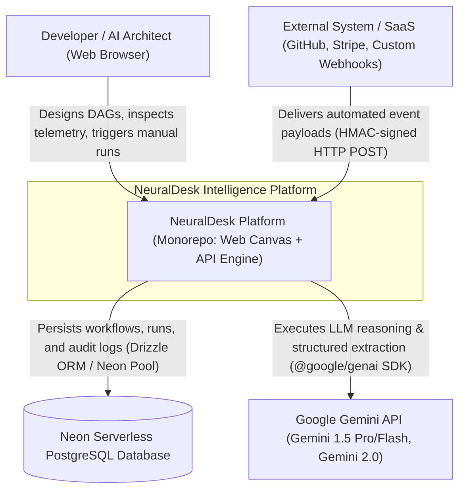
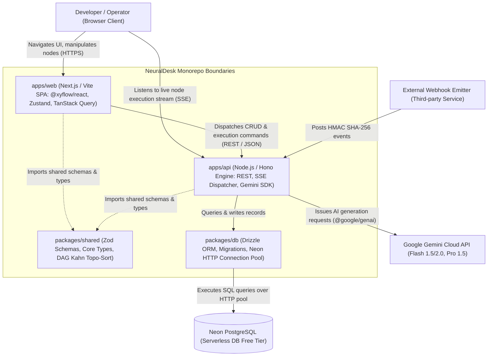
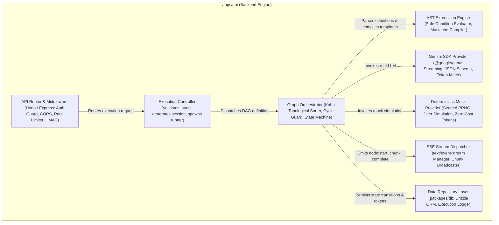
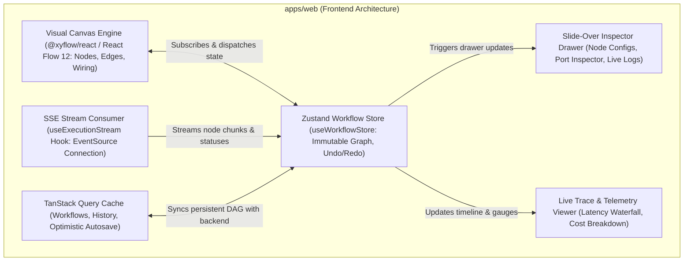

# 01. Architecture — C4 Architectural Models

[← Back to Documentation Portal](../README.md) | [← Overview](./overview.md) | [Next: Monorepo Structure →](./monorepo-structure.md)

---

## 2.1 C4 Level 1: System Context Diagram

The System Context diagram illustrates how NeuralDesk interacts with human users, external webhook sources, and cloud AI infrastructure:

---

## 2.2 C4 Level 2: Container Diagram

The Container diagram delineates the high-level technical boundaries of the NeuralDesk system:

---

## 2.3 C4 Level 3: Component Diagram for `apps/api`

---

## 2.4 C4 Level 3: Component Diagram for `apps/web`

---

[← Previous: Overview](./overview.md) | [Next: Monorepo Structure →](./monorepo-structure.md)
