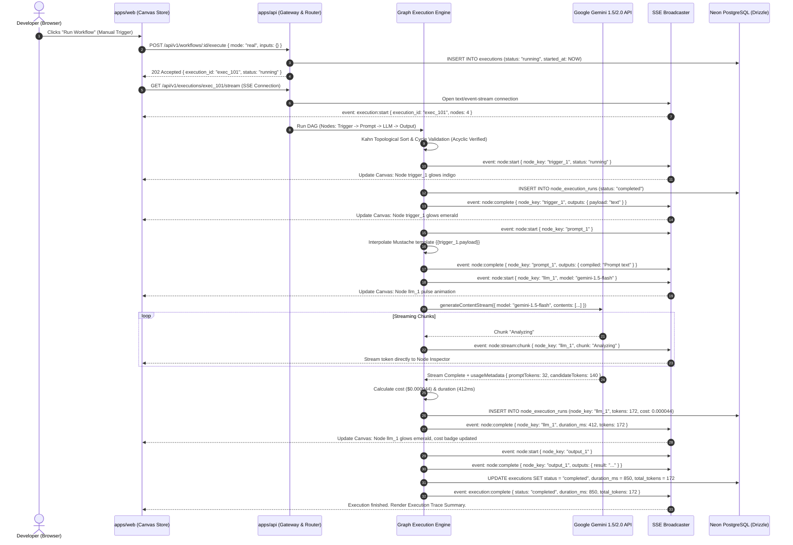

# 01. Architecture — Execution Sequence Diagrams

[← Back to Documentation Portal](../README.md) | [← Monorepo Structure](./monorepo-structure.md) | [Next Section: Database →](../02-database/er-diagram.md)

---

## 4.1 End-to-End Workflow Execution Sequence

The following sequence diagram tracks a complete execution cycle from visual trigger to Gemini streaming and database persistence:

---

[← Previous: Monorepo Structure](./monorepo-structure.md) | [Next Section: Database →](../02-database/er-diagram.md)
