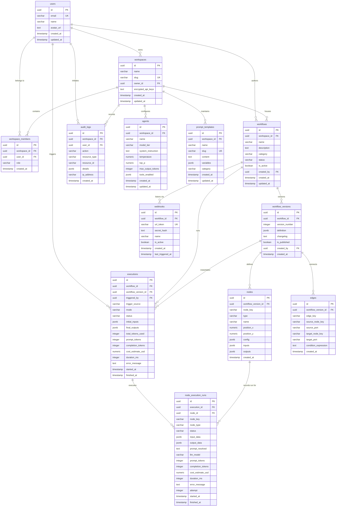

# 02. Database — Entity-Relationship (ER) Diagram & Cardinality

[← Back to Documentation Portal](../README.md) | [Next: Schema Models →](./schema-models.md)

---

## 1.1 Complete Entity-Relationship Model

NeuralDesk models its persistence layer across 13 core entities using strict relational constraints:

---

## 1.2 Entity Cardinality & Relational Governance

1. **Workspaces & Membership:** Users belong to Workspaces through `workspace_members`. Roles include `owner`, `admin`, `member`, `viewer`. Workspaces partition workflows, audit logs, and encrypted BYOK secrets.
2. **Workflows & Versions:** A Workflow possesses multiple immutable `workflow_versions`. Executions point to a specific version to guarantee reproducible execution audits.
3. **Execution Runs & Node Telemetry:** An `executions` row maintains aggregate telemetry (total duration, prompt/completion tokens, total USD cost). Every step instantiates a corresponding `node_execution_runs` row with microsecond timestamps and input/output snapshots.

---

[Next: Schema Models →](./schema-models.md)
