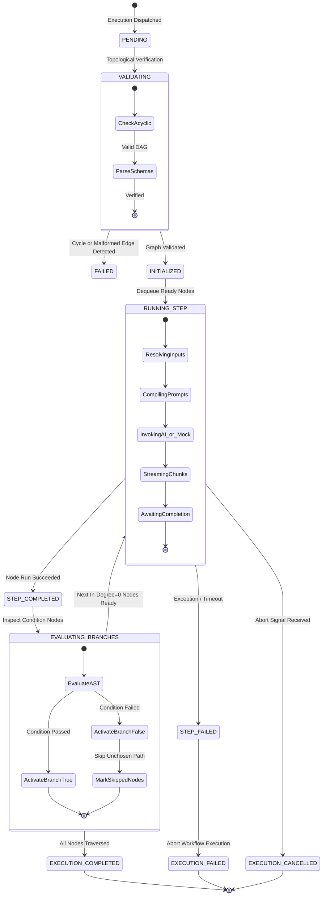

# 04. AI Engine — Graph Orchestration & Topological Execution

[← Back to Documentation Portal](../README.md) | [Next: Gemini Integration →](./gemini-integration.md)

---

## 1.1 Kahn's Algorithm & Cycle Path Isolation

Before execution, every workflow is validated as a Directed Acyclic Graph. NeuralDesk implements **Kahn's Topological Sort Algorithm** with Tarjan DFS cycle path detection in pure TypeScript:

```typescript
export interface GraphValidationResult {
  isValid: boolean;
  sortedOrder?: string[];
  cyclePath?: string[];
  error?: string;
}

export function topologicalSortKahn(
  nodeKeys: string[],
  edges: Array<{ source: string; target: string }>
): GraphValidationResult {
  const inDegree: Map<string, number> = new Map();
  const adjacencyList: Map<string, string[]> = new Map();

  for (const node of nodeKeys) {
    inDegree.set(node, 0);
    adjacencyList.set(node, []);
  }

  for (const edge of edges) {
    if (!inDegree.has(edge.source) || !inDegree.has(edge.target)) {
      return {
        isValid: false,
        error: `Edge references non-existent node: ${edge.source} -> ${edge.target}`,
      };
    }
    adjacencyList.get(edge.source)!.push(edge.target);
    inDegree.set(edge.target, inDegree.get(edge.target)! + 1);
  }

  const queue: string[] = [];
  for (const [node, degree] of inDegree.entries()) {
    if (degree === 0) queue.push(node);
  }

  const sortedOrder: string[] = [];
  while (queue.length > 0) {
    const current = queue.shift()!;
    sortedOrder.push(current);

    for (const neighbor of adjacencyList.get(current)!) {
      const updatedDegree = inDegree.get(neighbor)! - 1;
      inDegree.set(neighbor, updatedDegree);
      if (updatedDegree === 0) queue.push(neighbor);
    }
  }

  if (sortedOrder.length === nodeKeys.length) {
    return { isValid: true, sortedOrder };
  }

  const cycleNodes = nodeKeys.filter((n) => !sortedOrder.includes(n));
  return {
    isValid: false,
    error: `Graph contains a directed cycle involving nodes: [${cycleNodes.join(", ")}]`,
    cyclePath: cycleNodes,
  };
}
```

---

## 1.2 Execution Finite State Machine (FSM)



---

## 1.3 In-Memory Concurrency Queue & Free-Tier Throttling

To prevent server memory crashes (512MB RAM free tier) and Gemini rate limit errors (15 RPM free limit), NeuralDesk uses a priority FIFO concurrency queue:

* **Max Active Executions:** Default `3` simultaneous runs.
* **Backpressure Queue:** Additional incoming webhooks are placed in the queue in a `QUEUED` state.
* **Auto-Drain:** As an active execution completes, the next queued execution starts immediately.

---

## 1.4 Node Retry Policies & Fallback Model Routing

To handle transient network drops and `429 Too Many Requests` status codes from Google Gemini:

```typescript
export interface RetryPolicy {
  maxRetries: number; // e.g. 3
  initialDelayMs: number; // e.g. 1000ms
  backoffMultiplier: number; // e.g. 2.0 (1s, 2s, 4s)
  fallbackModel?: "gemini-1.5-flash" | "mock"; // Automatic downgrade if primary model fails
}
```

* **Automatic Fallback:** If `gemini-1.5-pro` repeatedly encounters rate limits or latency spikes, the engine automatically downgrades the prompt to `gemini-1.5-flash` or the deterministic mock runner.
* **Error Routing:** If all retries fail and the node has an `on_failure` output port wired, execution branches down the error path rather than terminating the workflow.

---

## 1.5 Human-in-the-Loop (HITL) Approval Transition

When a workflow hits an **Approval Node**:

1. The execution state transitions to `WAITING_FOR_APPROVAL`.
2. An entry is created in `approvals` with an ephemeral token and 7-day expiration.
3. The real-time SSE stream emits an `approval:required` event.
4. When a human reviewer submits `POST /api/v1/approvals/:id/decide` with `status: "approved"`, execution unpauses and proceeds downstream.

---

## 1.6 Standardized Variable Resolution Scope

NeuralDesk resolves dynamic variables with strict scope isolation:

| Scope Syntax | Example | Description |
| :--- | :--- | :--- |
| `{{nodes.<key>.output.<path>}}` | `{{nodes.extract_json.output.company}}` | References parsed output of an upstream completed node. |
| `{{trigger.body.<path>}}` | `{{trigger.body.customer_email}}` | References inbound webhook or manual trigger payload. |
| `{{env.<VAR_NAME>}}` | `{{env.SLACK_CHANNEL_ID}}` | References workspace-level environment variables. |
| `{{$execution.<prop>}}` | `{{$execution.id}}`, `{{$execution.timestamp}}` | Built-in execution runtime metadata. |

---

[Next: Gemini Integration →](./gemini-integration.md)
