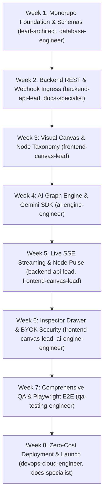

# 09. Roadmap — 8-Week Phased Implementation Plan

[← Back to Documentation Portal](../README.md) | [Next: RACI Matrix →](./raci-matrix.md)

---

## 1.1 Implementation Sprints Overview

---

## 1.2 Weekly Sprint Milestones

### Sprint 1 (Week 1): Monorepo Foundation & Schemas
* **Owners:** `lead-architect`, `database-engineer`
* **Deliverables:** pnpm monorepo structure, strict TypeScript configs, shared Zod schemas in `@neuraldesk/shared`, Drizzle ORM schema across all 13 tables, initial migration and seed fixtures.

### Sprint 2 (Week 2): Core REST API & Webhook Ingestion
* **Owners:** `backend-api-lead`, `docs-specialist`
* **Deliverables:** Hono backend REST endpoints (`/workspaces`, `/workflows`, `/versions`), HMAC SHA-256 webhook ingress, sliding window rate limiter, RFC 7807 error middleware.

### Sprint 3 (Week 3): Visual Canvas Engine & Custom Nodes
* **Owners:** `frontend-canvas-lead`
* **Deliverables:** `@xyflow/react` interactive canvas, 8 custom node types (`Trigger`, `LLM`, `Prompt`, `Condition`, `Transform`, `Tool`, `Evaluator`, `Output`), Zustand state store with 50-step undo/redo.

### Sprint 4 (Week 4): AI Orchestration Engine & Gemini SDK
* **Owners:** `ai-engine-engineer`
* **Deliverables:** Kahn's topological sort with cycle detection, Google Gemini 1.5/2.0 (`@google/genai`) SDK runner, token economics calculations, deterministic mock simulation engine.

### Sprint 5 (Week 5): Live SSE Streaming & Canvas Glow Pulse
* **Owners:** `backend-api-lead`, `frontend-canvas-lead`
* **Deliverables:** `GET /api/v1/executions/:id/stream` SSE dispatcher, client-side `useExecutionStream` hook, dynamic SVG animated glowing edges and node pulse states.

### Sprint 6 (Week 6): Node Inspector Drawer & BYOK Encryption
* **Owners:** `frontend-canvas-lead`, `ai-engine-engineer`
* **Deliverables:** Radix UI slide-over Inspector Drawer with live log streaming, Execution Trace waterfall viewer, AES-256-GCM encryption for tenant BYOK keys.

### Sprint 7 (Week 7): Comprehensive QA & Playwright E2E Suites
* **Owners:** `qa-testing-engineer`
* **Deliverables:** Vitest unit test suites for graph and compiler, API route integration tests, 3 Playwright browser journeys, CI automated quality gates.

### Sprint 8 (Week 8): Zero-Cost Cloud Deployment & Production Launch
* **Owners:** `devops-cloud-engineer`, `docs-specialist`
* **Deliverables:** Multi-stage Docker builds, GitHub Actions deploy pipeline, Vercel + Render + Neon free tier deployment, `/api/health` probes, final documentation verification.

---

[Next: RACI Matrix →](./raci-matrix.md)
